

  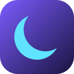

<h1 align="center">MoonBeam_IG</h1>

  Your Instagram DMs in a tiny desktop panel. None of the feed.

  <a href="https://github.com/zuhuHix/moonbeam-ig-releases/releases/latest"><b>Download</b></a> ·
  <a href="media/showcase.mp4">Video</a> ·
  <a href="#themes">Themes</a> ·
  <a href="#features">Features</a>

  <a href="media/showcase.mp4">
    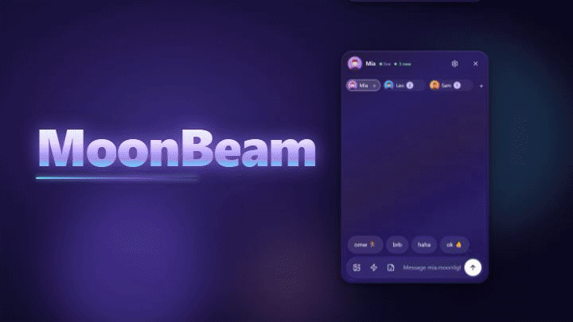
  </a>
   
  <a href="media/showcase.mp4">▶ Watch the 35 s video (with sound)</a>

## Why

- DMs without the feed and reels.
- Lives in your tray.
- Pops up only when someone writes.

## Themes

  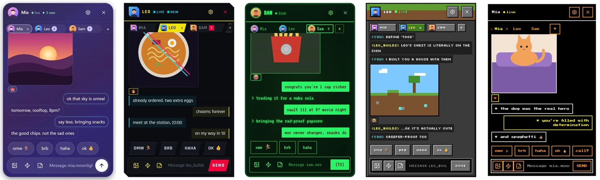
   
  MoonBeam · Cyberpunk 2077 · Fallout Pip-Boy · Minecraft · Undertale — <i>the popup pill follows the theme</i>

<table align="center">
  <tr>
    <td align="center"> MoonBeam</td>
    <td align="center">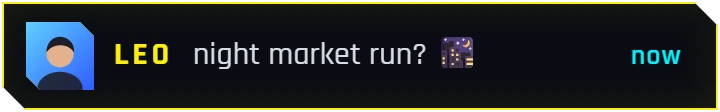 Cyberpunk 2077</td>
    <td align="center">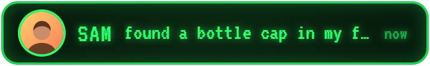 Fallout Pip-Boy</td>
  </tr>
  <tr>
    <td align="center">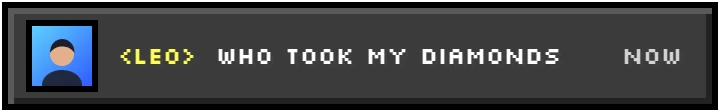 Minecraft</td>
    <td align="center">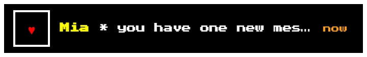 Undertale</td>
    <td align="center"> Drops in as a circle, opens from the middle</td>
  </tr>
</table>

## Features

<table align="center">
  <tr>
    <td align="center" valign="top">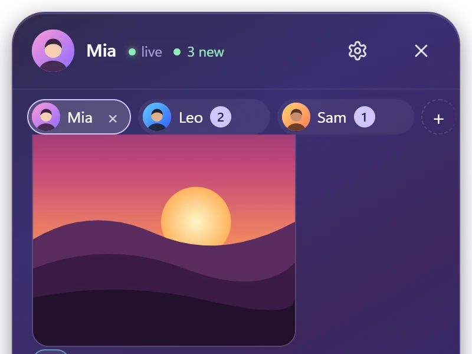 <b>Tab per friend</b> Up to 8 chats, unread badges, Ctrl+Tab.</td>
    <td align="center" valign="top"> <b>Island popups</b> No focus steal, hover to keep it, click opens that chat; DND from the tray.</td>
    <td align="center" valign="top">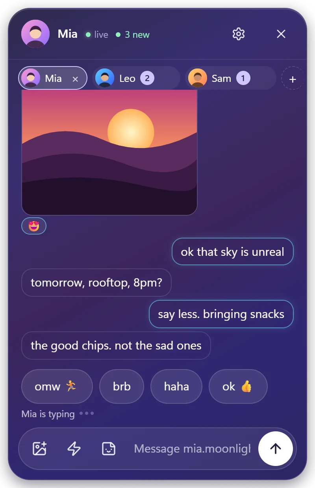 <b>Typing indicator</b> "Mia is typing" over the box, via the realtime socket.</td>
  </tr>
  <tr>
    <td align="center" valign="top">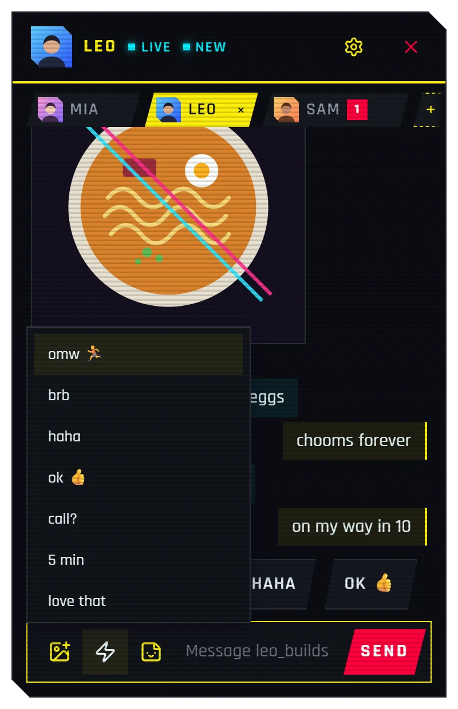 <b>Quick replies</b> ⚡, <code>/</code> in an empty box, or the chips above the composer; Shift+Enter sends.</td>
    <td align="center" valign="top">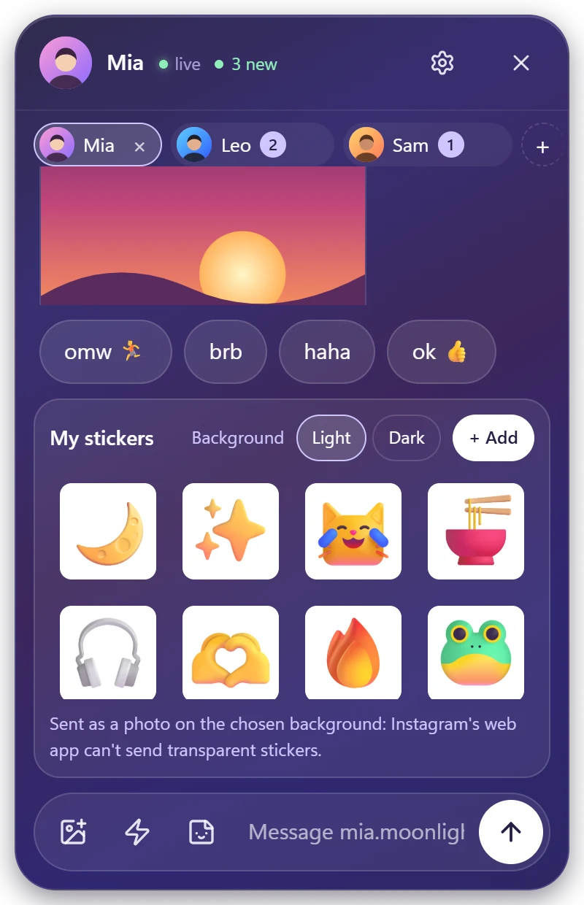 <b>My stickers</b> Your own PNG/WebP/GIF, sent as photos on a light or dark square.</td>
    <td align="center" valign="top">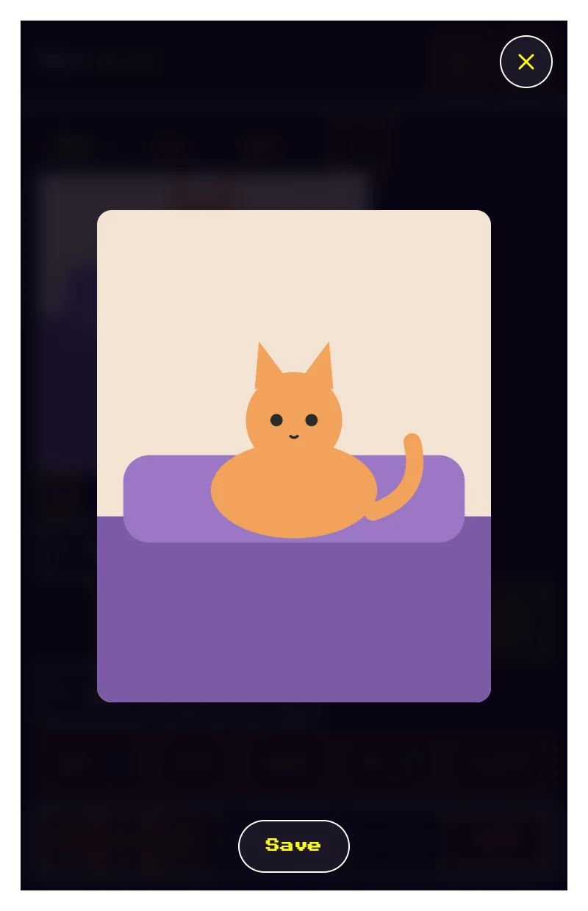 <b>Photo viewer</b> Full size, zoom, ←/→ through the chat's photos, Save.</td>
  </tr>
  <tr>
    <td align="center" valign="top">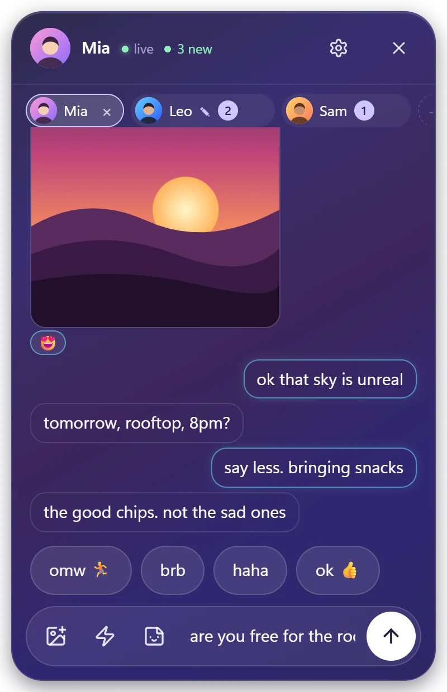 <b>Drafts per chat</b> Kept across tabs and restarts; the tab gets a marker.</td>
    <td align="center" valign="top">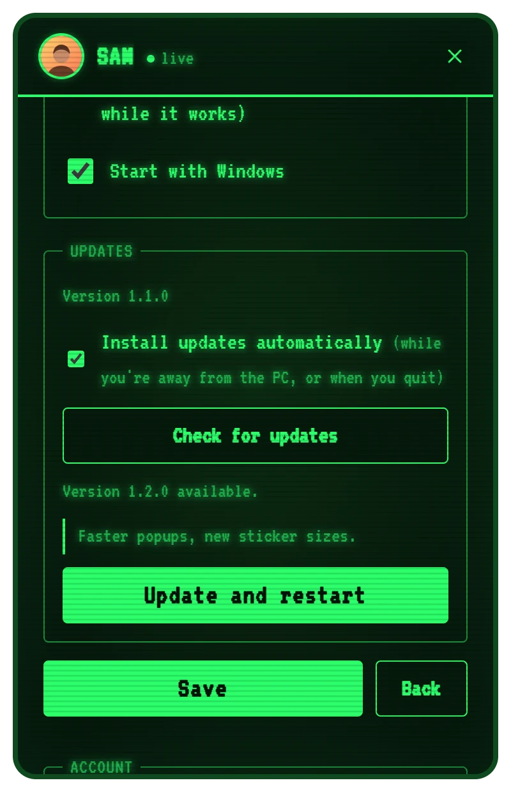 <b>Settings &amp; updates</b> Themes, popup position/duration, start with Windows, auto-updates that never interrupt unsent work.</td>
  </tr>
</table>

Also: outline bubbles (cyan for yours) · reactions · Esc → tray · start with Windows · instant notifications.

## Install

1. Download the installer from the [latest release](https://github.com/zuhuHix/moonbeam-ig-releases/releases/latest) and install it once.
2. Log in once. Instagram's own login page opens in a private window; only session cookies are kept, encrypted.
3. Add your people from your inbox.

From then on it updates itself. Windows 10/11 (WebView2).

> **Note:** Uses Instagram's unofficial web endpoints, which is against Instagram's ToS. Personal use only, at your own account risk.
>
> Not affiliated with Instagram or Meta. Instagram is a trademark of Meta Platforms, Inc.

Full video: [media/showcase.mp4](media/showcase.mp4)

